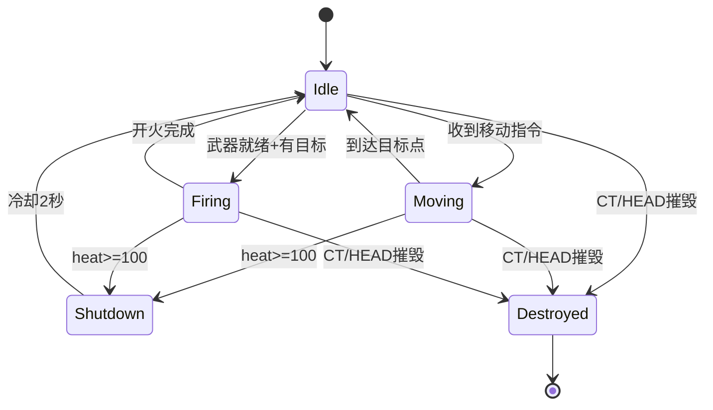

# MechCommander 2 核心系统详细设计文档

**版本**: 1.0  
**日期**: 2026-11-23  
**基于**: PyMC2 源码分析 (commit 8729fea)

---

## §1 设计目标

### 1.1 系统边界
本文档聚焦 MC2 三大核心系统的技术实现细节：
- **战斗系统**：命中判定、武器分类、伤害结算流程
- **机甲系统**：底盘属性、装配约束、状态转换
- **地形交互**：高程影响、视线遮挡、移动代价

### 1.2 设计原则
- **确定性优先**：同种子同结果（丘陵生成、伤害分配）
- **数值透明**：所有公式可测、可验证
- **渐进复杂度**：平地快路径保证存量行为零改动

---

## §2 核心流程

### 2.1 战斗回合流程

```
[玩家/AI 下达指令]
        ↓
[BattleService.tick(dt)]
        ↓
    ┌───────────────────────────┐
    │ 1. 武器冷却推进           │
    │    weapon.tick(dt)        │
    └───────────────────────────┘
        ↓
    ┌───────────────────────────┐
    │ 2. 热量散热               │
    │    heat.tick_cooling(dt)  │
    └───────────────────────────┘
        ↓
    ┌───────────────────────────┐
    │ 3. 移动协商 (让路判定)    │
    │    _advance_with_yield()  │
    └───────────────────────────┘
        ↓
    ┌───────────────────────────┐
    │ 4. 自动交战锁定           │
    │    _auto_engage()         │
    └───────────────────────────┘
        ↓
    ┌───────────────────────────┐
    │ 5. 开火判定               │
    │    fire_at() → 命中判定   │
    └───────────────────────────┘
        ↓
    ┌───────────────────────────┐
    │ 6. 弹丸飞行推进           │
    │    projectile.advance(dt) │
    └───────────────────────────┘
        ↓
    ┌───────────────────────────┐
    │ 7. 伤害结算               │
    │    apply_damage()         │
    └───────────────────────────┘
```

### 2.2 机甲状态转换图

```
        [初始部署]
             ↓
        ┌────────┐
        │ IDLE   │ ←─────────────────┐
        └────────┘                    │
         ↓  ↑  ↓                      │
   移动  ↓  ↑  ↓ 开火                 │
         ↓  ↑  ↓                      │
     ┌───────────┐  热量>=100         │
     │ MOVING /  │ ──────→ [SHUTDOWN] │
     │ FIRING    │         (2秒)      │
     └───────────┘                    │
         ↓                            │
     [受到伤害]                       │
         ↓                            │
     ┌────────────┐                   │
     │ 部位摧毁检查│                   │
     └────────────┘                   │
         ↓                            │
    CT/HEAD摧毁?                      │
      ↓Yes    ↓No                     │
  [DESTROYED] └──────────────────────┘
```

---

## §3 数据结构

### 3.1 武器属性表

| 武器类型    | 弹速倍率 | 弹道特性                | 部位判定规则     |
|------------|---------|------------------------|-----------------|
| BALLISTIC  | 1.5×    | 直射快弹                | 权重随机部位     |
| ENERGY     | 1.0×    | 激光束                  | 恒击中 CT       |
| MISSILE    | 0.7×    | 3发齐射 + 末端加速      | 散布 ±12px      |

**基础弹速**: 480 px/s  
**导弹加速度**: 240 px/s²

### 3.2 机甲底盘规格 (中型模板)

| 部位   | 装甲 | 内部结构 | 命中权重 | 摧毁后果                |
|--------|------|---------|---------|------------------------|
| HEAD   | 5    | 3       | 0.07    | 机甲全毁                |
| CT     | 12   | 9       | 0.25    | 机甲全毁                |
| LT     | 6    | 6       | 0.15    | 移动速度 -15%           |
| RT     | 6    | 6       | 0.15    | 移动速度 -15%           |
| LA     | 4    | 3       | 0.10    | 该臂武器失效            |
| RA     | 4    | 3       | 0.10    | 该臂武器失效            |
| LL     | 4    | 3       | 0.09    | 移动速度 -25%           |
| RL     | 4    | 3       | 0.09    | 移动速度 -25%           |

**总防护**: 装甲 45 + 结构 36 = 81点

### 3.3 地形参数表

| 地形类型 | 高度范围 | 移动代价乘数     | LOS 影响       |
|---------|---------|----------------|---------------|
| 平地 (0) | 0       | 1.0×           | 无遮挡         |
| 丘陵 (1) | 1       | 1.5× (上坡)    | 眼高 +1       |
| 高地 (2) | 2       | 2.25× (上坡)   | 眼高 +1       |
| 峭壁 (3) | 3       | 不可攀爬*      | 完全遮挡       |

\* 高差 > CLIMB_MAX_DELTA (1) 时拒绝移动

### 3.4 热量阈值效果

| 热量值 | 状态      | 效果                           |
|--------|----------|-------------------------------|
| 0-79   | 正常      | 无惩罚                         |
| 80-99  | 过热警告  | 命中率 ×0.7                   |
| 100    | 强制关机  | 冷却2秒，期间不可行动          |

**散热率**: 0.5 点/秒

---

## §4 算法伪代码

### 4.1 命中判定算法

```python
def resolve_shot(attacker, target, rng):
    """
    返回: ShotResult(hit, damage, impact_x, impact_y, location)
    """
    # 1. 计算距离与基础命中率
    distance = hypot(target.x - attacker.x, target.y - attacker.y)
    if distance >= attacker.weapon.range_px:
        return miss_result()
    
    base_accuracy = 1.0 - 0.75 * (distance / weapon_range)
    
    # 2. 技能加成 (rank 0→0.85, rank 5→1.15, 钳制[0.7,1.2])
    skill_mult = 0.85 + attacker.pilot.gunnery_rank * 0.06
    skill_mult = clamp(skill_mult, 0.7, 1.2)
    
    # 3. 热量惩罚
    heat_mult = 0.7 if attacker.heat >= 80 else 1.0
    
    # 4. 最终命中率
    final_accuracy = base_accuracy * skill_mult * heat_mult
    
    # 5. 随机判定
    if rng.random() < final_accuracy:
        location = roll_location(rng)  # 按权重表随机部位
        return ShotResult(hit=True, damage=weapon.damage, 
                         impact_x=target.x, impact_y=target.y,
                         location=location)
    else:
        # 未命中散布: 目标周围 8-48px 随机
        angle = rng.uniform(0, 2π)
        radius = rng.uniform(8.0, 48.0)
        return ShotResult(hit=False, damage=0,
                         impact_x=target.x + cos(angle)*radius,
                         impact_y=target.y + sin(angle)*radius,
                         location=CT)
```

### 4.2 部位伤害结算

```python
def apply_damage(chassis, hit_location, amount):
    """
    伤害传导链: 
    CT → LT → RT → LA → RA → LL → RL → HEAD
    """
    remain = amount
    chain_start = DAMAGE_CHAIN.index(hit_location)
    
    for location in DAMAGE_CHAIN[chain_start:]:
        if remain <= 0:
            break
            
        part = chassis.parts[location]
        
        # 先扣装甲
        armor_absorbed = min(part.armor, remain)
        part.armor -= armor_absorbed
        remain -= armor_absorbed
        
        # 再透结构
        if remain > 0:
            structure_absorbed = min(part.structure, remain)
            part.structure -= structure_absorbed
            remain -= structure_absorbed
    
    # 检查致死: CT或HEAD结构归零
    if chassis.parts[CT].structure <= 0 or \
       chassis.parts[HEAD].structure <= 0:
        return DESTROYED
```

### 4.3 视线遮挡判定 (Bresenham + 线性插值)

```python
def has_line_of_sight(elevation_grid, from_tile, to_tile):
    """
    眼高模型: 视线高度 = tile高程 + 1
    途经tile高程 >= 插值视线高度 → 遮挡
    """
    if elevation_grid.is_flat():
        return True  # 快路径
    
    x0, y0 = from_tile
    x1, y1 = to_tile
    
    sight_start = elevation_grid[y0][x0] + EYE_HEIGHT  # +1
    sight_end = elevation_grid[y1][x1] + EYE_HEIGHT
    
    # Bresenham直线遍历
    dx, dy = abs(x1-x0), abs(y1-y0)
    steps = max(dx, dy)
    
    if steps <= 1:
        return True  # 相邻/同格无途经tile
    
    step_x = 1 if x1>x0 else -1
    step_y = 1 if y1>y0 else -1
    x, y = x0, y0
    err = dx - dy
    
    for step in range(1, steps):  # 不含起点终点
        # Bresenham步进
        e2 = 2 * err
        if e2 > -dy:
            err -= dy
            x += step_x
        if e2 < dx:
            err += dx
            y += step_y
        
        # 插值视线高度
        t = step / steps
        sight_height = sight_start + (sight_end - sight_start) * t
        
        # 遮挡判定
        if elevation_grid[y][x] >= sight_height:
            return False
    
    return True
```

### 4.4 高程移动代价计算

```python
def calculate_move_speed_scale(from_tile, to_tile, elevation_grid):
    """
    返回速度乘数 (上坡惩罚, 下坡无影响)
    """
    h_from = elevation_grid.elevation_at(from_tile)
    h_to = elevation_grid.elevation_at(to_tile)
    
    delta = h_to - h_from
    
    # 检查攀爬限制
    if delta > CLIMB_MAX_DELTA:  # > 1
        return CANNOT_CLIMB
    
    # 下坡或平地
    if delta <= 0:
        return 1.0
    
    # 上坡: 每级 ×1.5 (复利)
    # delta=1 → 1.5×, delta=2 → 2.25×
    return CLIMB_COST_PER_LEVEL ** delta
```

---

## §5 边界处理

### 5.1 伤害溢出
**场景**: 单次伤害超过目标部位防护总和  
**处理**: 沿传导链向后续部位传递
```python
# 示例: 50点伤害击中LA (装甲4+结构3=7点)
remain = 50
remain = LA.damage(remain)   # 吸收7, 余43
remain = RA.damage(remain)   # 吸收7, 余36
remain = LL.damage(remain)   # 吸收7, 余29
# ... 继续传导直至耗尽
```

### 5.2 热量上限
**场景**: 单次开火产热超过100点上限  
**处理**: 钳制在100，触发强制关机
```python
def add_heat(self, amount):
    self.heat = min(MAX_HEAT, self.heat + amount)
    if self.heat >= MAX_HEAT:
        self.shutdown_timer = 2.0  # 2秒强制冷却
```

### 5.3 地图外坐标
**场景**: 视线判定/移动目标超出40×40边界  
**处理**: 地图外tile视为高程0 (平面延伸)
```python
def elevation_at(self, tile):
    x, y = tile
    if 0 <= x < 40 and 0 <= y < 40:
        return self._rows[y][x]
    return 0  # 越界返回0
```

### 5.4 让路死锁
**场景**: 两机甲相向移动互相阻塞  
**处理**: 90帧超时后强制通行
```python
# 连续被阻帧计数
if unit被阻挡:
    yield_ticks[unit.id] += 1
    if yield_ticks[unit.id] > 90:
        强制移动  # 超时逃生阀
else:
    yield_ticks[unit.id] = 0  # 清零计数
```

### 5.5 浮点精度
**场景**: 机甲血量计算累积误差  
**处理**: hull属性四舍五入到6位小数
```python
@property
def hull(self):
    return round(self.chassis.total_integrity, 6)
```

---

## §6 测试用例示例

### 6.1 命中率边界测试

```python
# 测试1: 贴脸命中率
attacker.x, attacker.y = 0, 0
target.x, target.y = 1, 0  # 距离1px
weapon.range_px = 400
probability = hit_probability(1, 400)
assert probability == 1.0  # 100%

# 测试2: 射程边缘衰减
probability = hit_probability(400, 400)
assert probability == 0.25  # 25%

# 测试3: 超出射程
probability = hit_probability(500, 400)
assert probability == 0.0  # 0%

# 测试4: 热量惩罚叠加
attacker.heat = 85
probability *= attacker.heat.accuracy_multiplier
assert probability == 0.25 * 0.7  # 17.5%
```

### 6.2 部位摧毁致死测试

```python
# 测试: CT摧毁导致机甲全毁
mech = Mech(id="test", faction=PLAYER)
mech.chassis.parts[CT].structure = 1.0

mech.apply_damage(location=CT, amount=100)

assert mech.chassis.parts[CT].structure == 0.0
assert not mech.alive  # 机甲被摧毁

# 测试: 腿部摧毁不致死但降速
mech.chassis.parts[LL].structure = 1.0
mech.apply_damage(location=LL, amount=10)

assert mech.alive  # 存活
assert mech.chassis.mobility_penalty == 0.25  # -25%速度
```

### 6.3 视线遮挡测试

```python
# 测试: 山脊遮挡
grid = ElevationGrid([
    [0, 0, 0, 1, 0, 0, 0],  # row=3有山脊
    # ...
])
assert not grid.has_line_of_sight(
    from_tile=(0, 3), 
    to_tile=(6, 3)
)

# 测试: 高地俯射通过
grid._rows[0][0] = 2  # 射手在2级高地
assert grid.has_line_of_sight(
    from_tile=(0, 0), 
    to_tile=(6, 3)
)  # 眼高3 > 山脊1
```

### 6.4 热量状态机测试

```python
# 测试: 热量累积→过热→关机→恢复
heat = HeatSystem()

heat.add_heat(85)  # 过热警告
assert heat.accuracy_multiplier == 0.7

heat.add_heat(20)  # 触顶关机
assert heat.heat == 100
assert heat.shutdown_active

heat.tick_cooling(2.0)  # 散热2秒
assert heat.heat == 99
assert not heat.shutdown_active
```

---

## 附录A: 关键常量汇总

```python
# 地图
MAP_TILES = 40
TILE_SIZE_PX = 32
MAP_SIZE_PX = 1280

# 机甲
MOVE_SPEED_PX_S = 96.0
HEADING_STEPS = 8  # 朝向分桶

# 武器
HIT_FALLOFF = 0.75
MIN_SCATTER_PX = 8.0
MAX_SCATTER_PX = 48.0
DEFAULT_PROJECTILE_SPEED_PX_S = 480.0

# 热量
MAX_HEAT = 100.0
COOLING_RATE_PER_S = 0.5
ACCURACY_PENALTY_THRESHOLD = 80.0
SHUTDOWN_DURATION_S = 2.0

# 高程
ELEVATION_MAX = 3
CLIMB_MAX_DELTA = 1
CLIMB_COST_PER_LEVEL = 1.5
EYE_HEIGHT_LEVELS = 1

# 技能
SKILL_BASE_MULTIPLIER = 0.85
SKILL_RANK_STEP = 0.06
```

---

## 附录B: 状态机图 (Mermaid格式)



---

**文档版本历史**:
- v1.0 (2026-11-23): 初始版本，基于PyMC2源码分析
